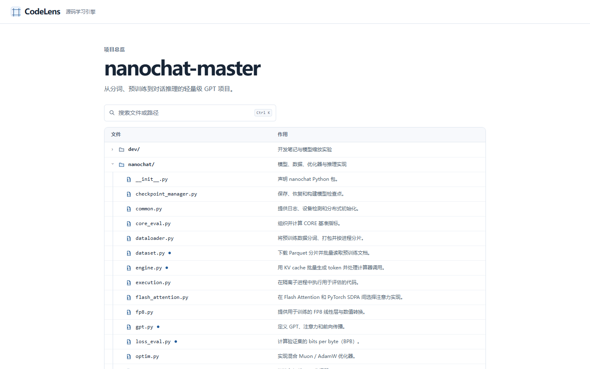
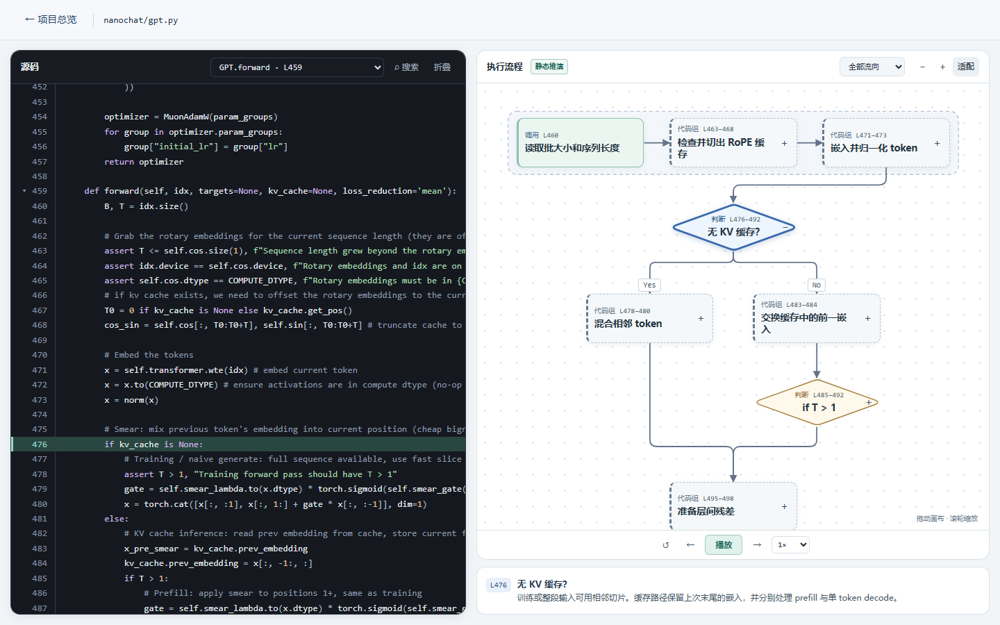

# CodeLens

[简体中文](README.zh-CN.md)

> See through the code. Turn reading source into exploring it.

CodeLens is an Agent Skill that turns a Python or TypeScript project into one offline HTML page. Open a file from the project tree, then explore its original source on the left and an interactive flowchart on the right.

## Preview

**Project overview** — Browse and search the nanochat file tree.



**Source explorer** — Follow the KV cache branch in `GPT.forward`. Click either the code or the flowchart to highlight the other.



[View the Python flowchart at 250% zoom](docs/images/python-zoom.png) · [View the TypeScript explorer](docs/images/typescript-explorer.png)

## Use as a Skill

From this repository, install into the project you want to explore:

```bash
python install.py --agent codex --project "/path/to/project"
```

Open Codex in that project and try:

```text
$codelens Generate an offline source explorer for this project. Start with the main entry point and write output/index.html.
```

You can also copy the entire [`codelens/`](codelens/) folder (not just `SKILL.md`) into a project-level skills directory:

| Agent | Install location | Invocation |
| --- | --- | --- |
| Codex | `.agents/skills/codelens/` | `$codelens` |
| Claude Code | `.claude/skills/codelens/` | `/codelens` |
| DeepSeek Harness | `.dsh/skills/codelens/` | `/codelens` with local skills enabled |

The installer accepts `codex`, `claude`, and `deepseek`. Codex discovery has been tested; for Claude Code and DeepSeek Harness, the installation layout and exporter were tested, but not a live model session.

## Run the examples without an Agent

Run these commands from this repository with **Python 3.11+**. Double-click the generated HTML to open it: no server, Node.js, or API key is needed for viewing.

### Python · nanochat

Replace `/path/to/nanochat` with your local checkout:

```bash
python codelens/scripts/codelens.py build "/path/to/nanochat" --language python --out output/index.html --analysis-out output/analysis.json
```

Open `output/index.html`, select `nanochat/gpt.py`, and choose `GPT.forward`. Click the KV cache decision to jump to its source, then select a branch in the diagram. For the exact walkthrough and verification steps, see the [nanochat test notes (Chinese)](examples/nanochat.md).

### TypeScript · Leaderboard

Exporting TypeScript requires Node.js. Install the pinned parser in CodeLens, not in the target project:

```bash
npm ci --ignore-scripts --prefix codelens/scripts
python codelens/scripts/codelens.py build examples/typescript-demo --notes examples/typescript-notes.json --out output/typescript.html
```

Open `output/typescript.html`, choose `src/main.ts` → `main`, and click line 12. Use `↗` to enter `normalize` in `src/score.ts`, then return to the call site. Open `src/badge.tsx` → `ScoreBadge` to see TSX. For your own project, replace the example path and omit its `--notes` file.

## What to expect

- The diagrams are **static**, not runtime traces. Calls that cannot be resolved are marked accordingly; TypeScript `paths` aliases and external packages are not resolved.
- CodeLens does not run the target project. It indexes source at export time and lays out each selected scope in the browser. [Optional AI notes](codelens/references/notes.md) are scoped and checked against source hashes.
- HTML and analysis JSON can embed complete source files. `output/` is ignored by Git. Use `--exclude` for private paths and review any exports before sharing. Use `--force` to refresh an existing CodeLens export.

## Tests and license

```bash
python -B -m unittest discover -s tests -v
node --test tests/test_graph.mjs
```

Browser regressions cover both examples over offline `file://`. See the [test instructions](examples/nanochat.md#重建); for TypeScript, run `node tests/typescript-browser.mjs output/typescript.html` after generating the example and installing Playwright.

CodeLens is [MIT-licensed](LICENSE). The Python screenshots show [Andrej Karpathy’s nanochat](https://github.com/karpathy/nanochat); its [license notice](docs/nanochat-LICENSE.txt) is included separately.
