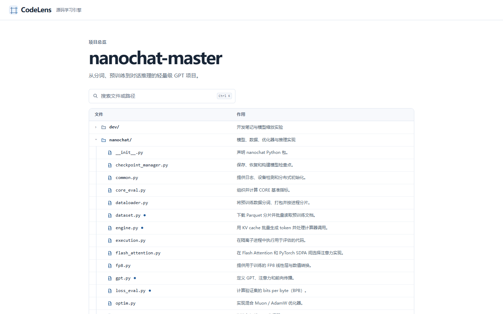
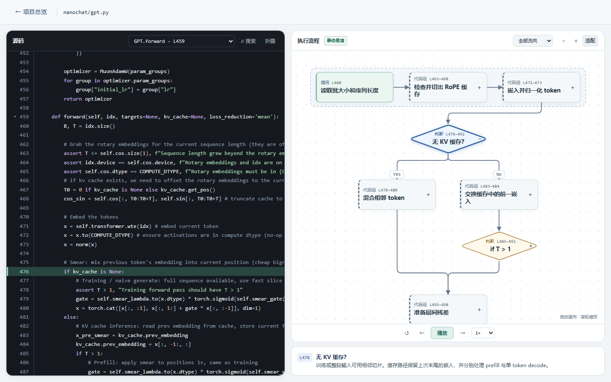

# CodeLens

[English](README.md)

> 给代码装上一副透视镜，让源码学习从阅读变成探索。

CodeLens 是一个源码学习 Skill，把 Python 或 TypeScript 项目导出成单个离线 HTML。先从文件树挑选文件，再在左侧看原始源码、右侧沿交互流程图探索。

## 界面预览

**项目总览**：浏览和搜索 nanochat 的真实文件目录。



**源码探索**：以 `GPT.forward` 的 KV 缓存分支为例，点击对应源码或流程节点，两侧同步高亮。



[查看 Python 流程图放大到 250% 的效果](docs/images/python-zoom.png) · [查看 TypeScript 探索页](docs/images/typescript-explorer.png)

## 安装并调用 Skill

在本仓库运行以下命令，把 Skill 装到你要探索的项目中：

```bash
python install.py --agent codex --project "/path/to/project"
```

在目标项目中打开 Codex，输入：

```text
$codelens 为这个项目生成离线源码探索页，从主入口开始，输出到 output/index.html。
```

也可将整个 [`codelens/`](codelens/) 目录复制到对应的项目级 Skill 位置，不要只复制 `SKILL.md`：

| Agent | 安装位置 | 调用方式 |
| --- | --- | --- |
| Codex | `.agents/skills/codelens/` | `$codelens` |
| Claude Code | `.claude/skills/codelens/` | `/codelens` |
| DeepSeek Harness | `.dsh/skills/codelens/` | 启用本地 Skill 后用 `/codelens` |

安装脚本支持 `codex`、`claude`、`deepseek`。已实测 Codex 原生发现；Claude Code 和 DeepSeek Harness 仅验证安装目录和导出器，未运行真实模型会话。

## 不用 Agent，直接试两个例子

在本仓库运行，需 **Python 3.11+**。生成后双击 HTML 即可查看，不需要服务器、Node.js 或 API 密钥。

### Python · nanochat

把 `/path/to/nanochat` 换成本地 nanochat 的路径：

```bash
python codelens/scripts/codelens.py build "/path/to/nanochat" --language python --out output/index.html --analysis-out output/analysis.json
```

打开 `output/index.html`，选择 `nanochat/gpt.py` → `GPT.forward`。点击 KV 缓存判断节点定位源码，再选择不同分支。验收快照的复现方法和更多操作见 [nanochat 实测记录](examples/nanochat.md)。

### TypeScript · 排行榜

TypeScript 导出需要 Node.js。只在 CodeLens 中安装锁定版本的解析器，不安装目标项目的依赖：

```bash
npm ci --ignore-scripts --prefix codelens/scripts
python codelens/scripts/codelens.py build examples/typescript-demo --notes examples/typescript-notes.json --out output/typescript.html
```

打开 `output/typescript.html`，选择 `src/main.ts` → `main`，点击第 12 行，再点 `↗` 进入 `src/score.ts` 的 `normalize`，最后返回调用处。打开 `src/badge.tsx` → `ScoreBadge` 可以查看 TSX。分析自己的项目时，替换示例路径并去掉 `--notes`。

## 使用边界

- 流程图是**静态推演**，不代表真实运行轨迹；无法确认的调用会标记，TypeScript 的 `paths` 别名和外部包不会被解析。
- CodeLens 不执行目标项目。导出时索引源码，浏览器按需布局当前函数。[AI 注释](codelens/references/notes.md) 可选，绑定具体源码片段和哈希。
- HTML 和分析 JSON 可能嵌入完整源码，Git 默认忽略 `output/`。可用 `--exclude` 排除私有路径，分享前仍需检查产物。如需刷新 CodeLens 已有导出文件，可加 `--force`。

## 测试与许可

```bash
python -B -m unittest discover -s tests -v
node --test tests/test_graph.mjs
```

两个示例均有离线 `file://` 浏览器回归。复现方式见[实测记录](examples/nanochat.md#重建)；安装 Playwright 并生成 TypeScript 示例后，可运行 `node tests/typescript-browser.mjs output/typescript.html`。

CodeLens 使用 [MIT 许可证](LICENSE)。Python 截图展示的是 [Andrej Karpathy 的 nanochat](https://github.com/karpathy/nanochat)，其[许可声明](docs/nanochat-LICENSE.txt)单独保留。
